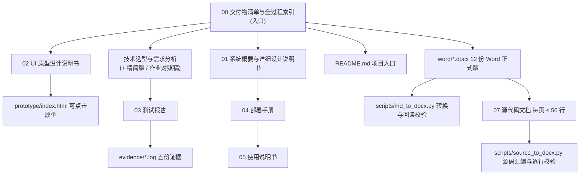

# 交付物清单与全过程索引

> 项目：私有文档知识库问答助手（kb-assistant） · v1.0.0
> 编写日期：2026-11-17
> 用途：回答「从设计到完成的材料是否齐全」——**逐项审计 + 补齐 + 可复现的自查方法**。本文是整个 `docs/` 的入口。
> **提交格式：Word（.docx）**——正式交付版见 `docs/word/`（12 份：11 份文档 + 1 份源代码文档）；本文为可编辑 Markdown 源文件，两者正文一致。

---

## 一、审计结论（先看这里）

对照「需求分析 → 设计/原型 → 代码 → 测试 → 部署 → 使用 → 全过程记录」七个阶段逐项核对，结果如下：

| 阶段 | 要求材料 | 审计前状态 | 本次补充 | 现在 |
|---|---|---|---|---|
| ① 需求分析 | 需求分析、技术选型、功能描述 | ✅ 已有 3 份 | 在本文建立索引与口径校准提示 | ✅ |
| ② 设计文档 | 架构/数据库/接口/流程设计 | ⚠️ 零散写在需求分析 §3 与 README，无独立设计说明书 | `docs/01-系统概要与详细设计说明书.md` | ✅ |
| ③ 原型设计 | 页面线框、交互规格、可点击原型 | ❌ 完全缺失 | `docs/02-UI原型设计说明书.md` + `docs/prototype/index.html` | ✅ |
| ④ 代码 | 前后端、桌面端、脚本、依赖锁定、CI | ✅ 完整 | 修复 2 处真实缺陷（`text.py`、`retrieval.py`）；CI 增加测试步骤 | ✅ |
| ⑤ 测试 | 测试用例、测试报告、执行证据 | ⚠️ 只有 1 个冒烟脚本 + 2 份日志，无用例集/报告 | `backend/tests/test_all.py`（39 用例）+ `docs/03-测试报告.md` + 3 份回归日志 | ✅ |
| ⑥ 部署 | 部署手册、配置参考、验收、故障排查 | ⚠️ README 与 backend/README 有零散说明，无独立手册 | `docs/04-部署手册.md` | ✅ |
| ⑦ 使用说明 | 面向最终用户的操作手册与 FAQ | ❌ 完全缺失 | `docs/05-使用说明书.md` | ✅ |
| ⑧ 全过程记录 | 阶段索引、开发时间线 | ❌ 缺失 | 本文 | ✅ |
| ⑨ 提交格式 | 交付文档统一为 Word | ❌ 全部为 Markdown，无 Word 版 | `docs/word/` 下 12 份 `.docx` + 2 个生成脚本 + 2 份生成日志 | ✅ |
| ⑩ 源代码文档 | 源码清单，每页 ≤ 50 行代码 | ❌ 无独立源码文档 | `docs/word/07-源代码文档.docx`（52 个文件 / 6121 行 / 123 个代码页）+ `scripts/source_to_docx.py` + 生成日志 | ✅ |

**一句话结论**：代码与需求分析原本齐全；**设计说明书、UI 原型、正式测试报告与用例集、部署手册、使用说明书、全过程索引**六类材料原先缺失或不成文，现已全部补齐；随后按作业要求把交付文档统一转为 Word 正式版（12 份），并补充逐字收录源码、每页不超过 50 行的《源代码文档》。另有 2 个真实代码缺陷在编写测试用例时被发现并修复。

## 二、交付物总清单

### ① 需求与立项

| 文件 | 内容 |
|---|---|
| `docs/技术选型与需求分析.md` | 完整版：技术选型（4 层架构、语言/框架/数据库/形态对比）、需求背景、F1~F11、非功能需求、模块划分、核心流程、评分自查 |
| `docs/技术选型与需求分析-精简版.md` | 提交表格用的精简口径 |
| `docs/作业要求对照-技术选型与需求分析填写稿.md` | 按评分表逐行对照的填写稿；**内含重要口径提醒：按作业判分标准应答「3 种编程语言 + SQL」** |

### ② 设计

| 文件 | 内容 |
|---|---|
| `docs/01-系统概要与详细设计说明书.md` | 分层/部署架构、模块职责、ER 图、7 张表字段与索引、文档状态机、17 个端点契约、SSE 事件格式、错误码、入库/问答时序图、算法与权衡、需求↔设计↔代码追溯、已知限制 |
| `docs/02-UI原型设计说明书.md` | 信息架构、页面清单、P0/P1-a/P1-b 三张低保真线框、14 条交互规格、色板与视觉规范、需求→界面追溯、原型与实现边界 |
| `docs/prototype/index.html` | **可点击高保真原型**：登录/注册、工作台、文档上传与状态、模拟 SSE 流式问答、引用浮层、反馈、设计标注模式；双击即可打开，零依赖、不发网络请求 |

### ③ 代码与工程

| 路径 | 内容 |
|---|---|
| `backend/app/` | FastAPI 服务：`api/` 四组路由 · `services/` 五个服务 · `core/` 配置与安全 · `models.py` / `schemas.py` / `db.py` |
| `backend/scripts/` | `smoke_test.py` 端到端冒烟 · `reindex_all.py` 换模型后重建索引 · `make_seed_db.py` 空白种子库 · `prepare-backend.bat` 打包前 venv |
| `backend/tests/test_all.py` | **本次新增**：39 个单元/接口/安全用例（标准库 `unittest`，临时隔离数据库） |
| `backend/requirements.txt` / `.env.example` | 依赖锁定与配置样板 |
| `frontend/src/` | `pages/Login`、`pages/Workspace`、`components/DocPanel`、`components/ChatPanel`、`api.ts`、`types.ts`、`index.css` |
| `frontend/package.json` / `package-lock.json` / `vite.config.ts` | 前端工程与依赖锁定 |
| `src-tauri/` | `src/main.rs` 桌面外壳、`tauri.conf.json`、`capabilities/`、`windows/` 卸载清理、`nsis/` 安装包兜底、`icons/` |
| `.github/workflows/ci.yml` | CI：后端 39 用例 + 冒烟 + 种子库校验；前端 `npm ci` + 构建（**本次新增测试步骤**） |
| `demo-files/` | 虚构演示文档（PDF/DOCX/MD/TXT/CSV）及生成脚本 |
| `scripts/md_to_docx.py` | Markdown → Word 批量高保真转换 + `--check` 回读校验（11 份文档） |
| `scripts/source_to_docx.py` | 源码 → Word 汇编：每页 ≤ 50 行、带行号/文件目录 + `--check` 逐行校验（07 源代码文档） |
| `LICENSE` / `.gitignore` / `README.md` / `backend/README.md` | 许可、忽略规则、项目入口、后端说明 |

**本次代码改动（缺陷修复，详见测试报告 §六）**

| 文件 | 改动 |
|---|---|
| `backend/app/services/text.py` | 页脚正则支持「第 N 页 / 共 M 页」「N / M 页」等常见形态，修复清洗残留（DEF-01） |
| `backend/app/services/retrieval.py` | 关键词提取改为按出现顺序去重保序、拉丁型号词优先，消除跨进程结果不确定（DEF-02） |
| `.github/workflows/ci.yml` | 新增 `Unit & API tests` 步骤 |
| `README.md` | 新增「交付物清单」导航，更新进度勾选 |

### ④ 测试

| 文件 | 内容 |
|---|---|
| `docs/03-测试报告.md` | 目的与范围、环境、分层策略、39 条用例明细、端到端与构建结果、F1~F11 覆盖追溯、缺陷记录、非功能结论、结论与复现命令 |
| `docs/evidence/01-端到端冒烟测试.log` | 历史证据：`hashing + mock` 零依赖配置全链路通过 |
| `docs/evidence/02-前端构建.log` | 历史证据：前端构建 |
| `docs/evidence/03-单元与接口自动化测试.log` | **本次**：`Ran 39 tests ... OK`（1.221s） |
| `docs/evidence/04-回归-端到端冒烟测试.log` | **本次**：真实 Ollama（`bge-m3` + `qwen2.5:3b`）全链路通过 |
| `docs/evidence/05-回归-前端构建.log` | **本次**：`tsc --noEmit && vite build` 通过 |
| `docs/evidence/06-文档格式转换.log` | **本次**：11 份 Markdown → Word 转换与 11/11 PASS 回读校验 |
| `docs/evidence/07-源代码文档生成.log` | **本次**：52 个文件 / 6121 行源码汇编，123 个代码页、逐字一致、`CHECK_RESULT=PASS` |

### ⑤ 部署与使用

| 文件 | 内容 |
|---|---|
| `docs/04-部署手册.md` | 4 种部署形态、环境矩阵、`.env` 全参数表、逐步部署命令、Nginx/SSE 反代、桌面安装包打包与卸载、备份恢复/升级回滚、验收清单、故障排查、安全加固、CI/CD |
| `docs/05-使用说明书.md` | 五分钟上手、账号/知识库/文档/问答逐项操作、引用怎么看、桌面端特有操作、数据位置与隐私、FAQ、已知限制 |

### ⑥ 全过程记录

| 文件 | 内容 |
|---|---|
| `docs/00-交付物清单与全过程索引.md`（本文） | 审计结论、总清单、阶段门禁、时间线、自查命令、待校准项、提交打包建议 |
| `docs/evidence/06-文档格式转换.log` | **本次**：11 份 Markdown → Word 的转换与回读校验记录 |
| `docs/evidence/07-源代码文档生成.log` | **本次**：52 个源码文件汇编、逐行一致性与每页 ≤ 50 行的校验记录 |

### ⑦ Word 正式交付版（提交用，统一格式）

> 作业要求交付文档统一为 Word。全部 **12 份** `.docx` 位于 `docs/word/`：其中 11 份由 Markdown 转换，1 份《源代码文档》由 52 个源码文件汇编。均采用统一封面（项目名 / 文档名 / 版本 / 日期 / 来源）、目录、页眉页脚与页码；文档版保留标题层级、表格（表头底色 + 重复表头）、代码块（等宽字体 + 底纹）、引用块、任务清单与超链接，**正文未改写**；源代码版逐字收录、带 4 位行号、**每页最多 50 行代码**。

| Word 文件（`docs/word/`） | Markdown 源文件 / 来源 |
|---|---|
| `00-交付物清单与全过程索引.docx` | `docs/00-交付物清单与全过程索引.md` |
| `01-系统概要与详细设计说明书.docx` | `docs/01-系统概要与详细设计说明书.md` |
| `02-UI原型设计说明书.docx` | `docs/02-UI原型设计说明书.md` |
| `03-测试报告.docx` | `docs/03-测试报告.md` |
| `04-部署手册.docx` | `docs/04-部署手册.md` |
| `05-使用说明书.docx` | `docs/05-使用说明书.md` |
| `07-源代码文档.docx` | `scripts/source_to_docx.py` 从 52 个源码文件汇编（无单一 md 源） |
| `技术选型与需求分析.docx` | `docs/技术选型与需求分析.md` |
| `技术选型与需求分析-精简版.docx` | `docs/技术选型与需求分析-精简版.md` |
| `作业要求对照-技术选型与需求分析填写稿.docx` | `docs/作业要求对照-技术选型与需求分析填写稿.md` |
| `README-项目总览.docx` | `README.md` |
| `README-后端说明.docx` | `backend/README.md` |

- 生成工具：`scripts/md_to_docx.py`（11 份文档转换）与 `scripts/source_to_docx.py`（源码汇编）；均为 `python-docx` 本地运行、无网络与外部服务依赖、不做 AI 改写。
- 复现命令：`backend/.venv/Scripts/python.exe scripts/md_to_docx.py` 与 `backend/.venv/Scripts/python.exe scripts/source_to_docx.py`；只校验分别加 `--check`。
- 校验结果：**11 / 11 PASS**（回读 docx 逐行比对 820+ 条标题/表格首列/代码块/正文，缺失 0；检查 zip、封面/目录/页眉页脚/页码域/超链接，日志见 `docs/evidence/06-文档格式转换.log`）；**《源代码文档》CHECK_RESULT=PASS**（52 个文件 / 6121 行逐字一致，123 个代码页每页 21–50 行，最大估算页高 526pt < A4 可用 748pt，日志见 `docs/evidence/07-源代码文档生成.log`）。
- 保持原格式的非文档资产：`docs/prototype/index.html`（可点击原型，交互无法用 Word 承载）、`docs/evidence/*.log`（执行证据）、`backend/tests/test_all.py` 与全部源码（但已在《源代码文档》中逐行收录）。
- 源文件与 Word 版一一对应：`README.md` 与 `backend/README.md` 同名，故 Word 版分别命名为 `README-项目总览.docx`、`README-后端说明.docx`；Word 内的相对链接会重映射到对应 `.docx` 或仓库内原文件。
- 《源代码文档》收录 5 个模块 52 个文件：后端服务、后端脚本与测试、前端、桌面端、工程配置与工具脚本；排除 npm 锁文件、Tauri 自动生成的 schema、运行时数据与已有独立文档的 README/LICENSE，理由见该文档「编制说明」。

## 三、阶段门禁：输入 → 产出 → 验收

| 阶段 | 输入 | 产出 | 验收方式 |
|---|---|---|---|
| 需求分析 | 课程作业要求、痛点调研 | 3 份需求/技术选型文档 | 评分对照自查表逐行打勾 |
| 概要/详细设计 | 需求文档 | §01 设计说明书（架构、ER、接口、时序、算法） | 与 `models.py` / 路由代码逐项核对；接口数、字段、状态码一致 |
| 原型设计 | 功能清单 F1~F11 | §02 线框 + 交互规格 + 可点击 HTML 原型 | 每个需求能找到对应界面控件；原型可完成登录→建库→上传→提问→点引用全流程 |
| 编码实现 | 设计说明书、原型 | `backend/` `frontend/` `src-tauri/` `scripts/` | 冒烟脚本 + Swagger 全部接口可调通 + 桌面端安装演示 |
| 测试 | 需求 F1~F11、设计契约 | 39 用例 + 测试报告 + 5 份证据日志 | `Ran 39 tests ... OK`；需求覆盖追溯表；缺陷闭环 |
| 部署 | 代码、配置样板 | 部署手册、桌面安装包 | 部署验收清单（12 项）逐项通过；安装包白名单核对 |
| 交付使用 | 部署产物 | 使用说明书、演示脚本 | 按说明书从零操作一遍能完成一次完整问答 |
| 格式统一 | 全部 Markdown 交付文档 | `docs/word/` 下 12 份 `.docx` + 2 个生成脚本 + 2 份日志 | `md_to_docx.py --check` 与 `source_to_docx.py --check` 均输出 `CHECK_RESULT=PASS`；正文与源文件一致 |
| 源代码归档 | 52 个手写源码/配置文件 | `docs/word/07-源代码文档.docx`（123 个代码页，每页 ≤ 50 行、带行号与文件目录） | 回读逐行比对 6121 行完全一致；每页行数 ≤ 50；最大估算页高 526pt < A4 可用 748pt |
| 归档 | 以上全部 | 本文（全过程索引） | `git status` 干净、无敏感文件入库、所有文档链接可达 |

## 四、开发过程时间线

> Git 历史目前只有 1 次提交（`ac79ce1 2026-11-15 Initial commit`），全过程主要依据**文件时间戳 + 证据日志**还原；建议后续按阶段补做有意义的提交信息，让过程在版本库里也可追溯。

| 日期 | 阶段 | 主要产出（依据文件时间戳） |
|---|---|---|
| 2026-11-10 09:58–10:07 | 后端骨架 | `core/security.py`、`models.py`、`api/*`、`services/*`、`db.py`、`smoke_test.py` |
| 2026-11-10 10:36–10:46 | 前端骨架 + 需求分析 | `index.html`、`App.tsx`、`Login/Workspace`、3 份需求文档 |
| 2026-11-11 09:14–11:18 | 界面与桌面端 | `DocPanel`、`ChatPanel`、`index.css`、`api.ts`、`src-tauri/`、图标、演示文档生成脚本 |
| 2026-11-14 23:04–23:27 | 联调与卸载能力 | 本机运行调试、`hooks.nsh`、`uninstall-cleanup.ps1` |
| 2026-11-15 11:33–12:32 | 真实模型接入与 Prompt 迭代 | `.env` 切 Ollama、重建索引备份、`llm.py` 多轮不串味与引用标注优化 |
| 2026-11-15 17:39–17:43 | 打包与安全加固 | `prepare-backend.bat`、`setup.nsi`、`tauri.conf.json` 白名单、JWT/CORS 安全默认、`README.md`、`LICENSE`、初始提交 |
| 2026-11-17 19:36 | 首次测试证据 | `evidence/01` 冒烟、`evidence/02` 前端构建 |
| **2026-11-17 19:38–19:45** | **交付物审计与补全（本次）** | 6 份文档 + 可点击原型 + 39 个自动化用例 + 3 份回归日志 + 2 处缺陷修复 + CI/README 更新 |
| **2026-11-17 19:57 起（本次追加）** | **交付格式统一** | `scripts/md_to_docx.py` + 11 份 Word 正式版 + 转换/回读校验日志；README 与本文增设 Word 版导航 |
| **2026-11-17 20:21 起（本次追加）** | **源代码文档** | `scripts/source_to_docx.py` + `docs/word/07-源代码文档.docx`（52 文件 / 6121 行 / 123 代码页 / 每页 ≤ 50 行）+ 生成与逐行校验日志 |

## 五、30 秒自查：怎么验证材料是真的

```bash
# 1) 代码可跑：39 个自动化用例（隔离临时库，不污染开发数据）
cd backend && .venv/Scripts/python.exe -m unittest discover -s tests -p "test_*.py" -v

# 2) 全链路可跑
.venv/Scripts/python.exe scripts/smoke_test.py

# 3) 前端可构建
cd ../frontend && npm run build

# 4) 文档与证据是否齐全（在仓库根目录）
ls docs/*.md docs/prototype/index.html docs/evidence/*.log backend/tests/*.py scripts/*.py
ls docs/word/*.docx                                        # 应为 12 份 Word 正式版

# 5) Word 版可打开且与源文件一致（回读校验）
backend/.venv/Scripts/python.exe scripts/md_to_docx.py --check         # 11 份文档，CHECK_RESULT=PASS
backend/.venv/Scripts/python.exe scripts/source_to_docx.py --check      # 源代码文档，逐行一致 + 每页行数 CHECK_RESULT=PASS

# 6) 原型：双击 docs/prototype/index.html，走一遍登录→建库→上传→提问→点引用

# 7) 敏感数据未入库
git status --short && grep -nE '^\s*\.(env|venv|data)' .gitignore
```

预期：步骤 1 输出 `Ran 39 tests ... OK`；步骤 2 输出「全链路通过…」；步骤 3 零类型错误；步骤 4 列出 9 份 md、1 份 html、7 份 log、2 份生成脚本 py、12 份 docx；步骤 5 两条命令均输出 `CHECK_RESULT=PASS`（源代码文档还会给出每页行数 min/max 与页高估算）。

## 六、文档导航



## 七、待校准项与遗留项（提交前请确认）

审计中发现以下**文档口径不一致**或**功能未闭环**，均已在 `docs/03-测试报告.md` §六登记，此处集中列出便于一次性处理：

| 编号 | 类型 | 说明 | 建议 |
|---|---|---|---|
| CAL-01 | 口径不一致 | `README.md`、`技术选型与需求分析.md`、精简版写「4 种编程语言」；`作业要求对照…填写稿.md` 明确按评分口径应为「3 种 + SQL」 | 按作业对照稿统一为 **3 种编程语言（TS 归 HTML/CSS/JS 一类、Python、Rust）+ SQL**，对外表述照此 |
| CAL-02 | 事实不一致 | 需求文档写全局快捷键 `Ctrl+Shift+Space`，`src-tauri/src/main.rs` 与 `README.md` 实为 **`Ctrl+Shift+K`** | 以代码为准，把需求文档改为 `Ctrl+Shift+K`（本次新增文档已按 `Ctrl+Shift+K` 书写） |
| CAL-03 | 数量不一致 | 需求文档写「14 个接口」，实际为 **17 个业务端点 + `/health`** | 按 `docs/01` §4.1 的清单统一 |
| OBS-01 | 功能未闭环 | F11 声称「一键重新索引」，后端 `POST /reindex` 已实现并有 TC-API-16 覆盖，但 `DocPanel.tsx` 无按钮 | 前端补按钮，或把需求措辞改为「接口支持重新索引」 |
| OBS-02 | 指标口径 | 「流式首字 < 2s」在 `mock` 成立，真实 Ollama 3B 完整生成约 11.6s | 按 provider 区分表述；或把「首字延迟」与「完整生成耗时」分开计量 |
| OBS-03 | 日志观感 | 测试日志有 `StarletteDeprecationWarning` | 不影响结果，按 FastAPI 升级指引迁移 `httpx2` |
| OBS-04 | 过程可追溯性 | Git 仅有 1 次提交，过程靠文件时间戳与日志还原 | 按阶段补做提交，提交信息写明阶段名 |

> 以上均为**非阻断项**，不影响「材料齐全」结论；CAL-01/02/03 建议在提交前统一，避免评审现场追问。

## 八、提交/打包建议

**应提交**：`docs/` 全部（含 **`word/` 12 份 Word 正式版**、`prototype/` 与 `evidence/`）、`scripts/md_to_docx.py`、`scripts/source_to_docx.py`、`backend/app/`、`backend/scripts/`、`backend/tests/`、`backend/requirements.txt`、`backend/.env.example`、`backend/README.md`、`frontend/src/`、`frontend/` 配置与锁文件、`frontend/dist/`（可选，构建产物）、`src-tauri/` 源码与配置（**排除 `target/`**）、`.github/`、`demo-files/`、`LICENSE`、`.gitignore`、`README.md`。

**不应提交**（已被 `.gitignore` 覆盖，交付前再核对一次）：`backend/.env`、`backend/.venv/`、`backend/data/app.db` 与 `uploads/`、`*.bak`、`data/secret.key`、`frontend/node_modules/`、`src-tauri/target/`、`backup-installed-data/`、`.pgvector-src/`、安装包 exe。

> **注意 1**：原 `.gitignore` 的 `*.log` 会把 `docs/evidence/` 下测试证据一起忽略，导致「有报告没证据」。本次已补充例外规则 `!docs/evidence/*.log`，提交前用 `git status --short docs/evidence` 确认 7 份日志都在待提交列表里。
>
> **注意 2**：`.gitignore` 未忽略 `.docx`，提交前用 `git status --short docs/word` 确认 12 份 Word 正式版都在待提交列表里；Word 文档不要只留在本地。

**推荐提交顺序**（与阶段门禁一致）：需求文档 → 设计 + 原型 → 代码 → 测试 → 部署/使用说明 → 全过程索引；每一步配一条有意义的提交信息，版本库本身也成为「全过程材料」。
