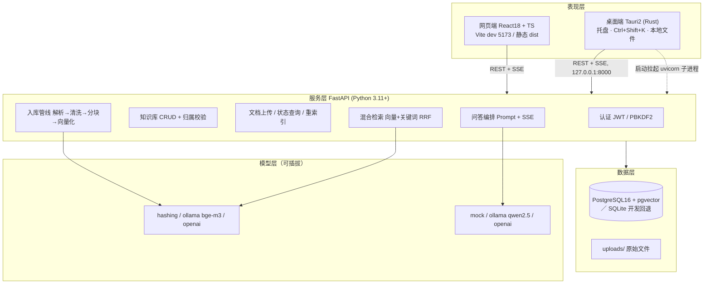
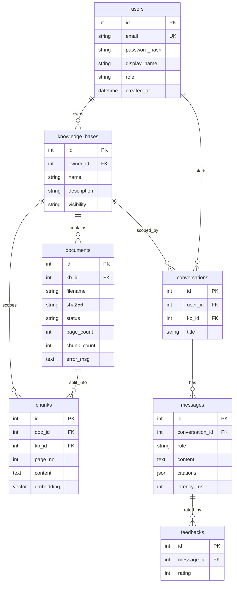
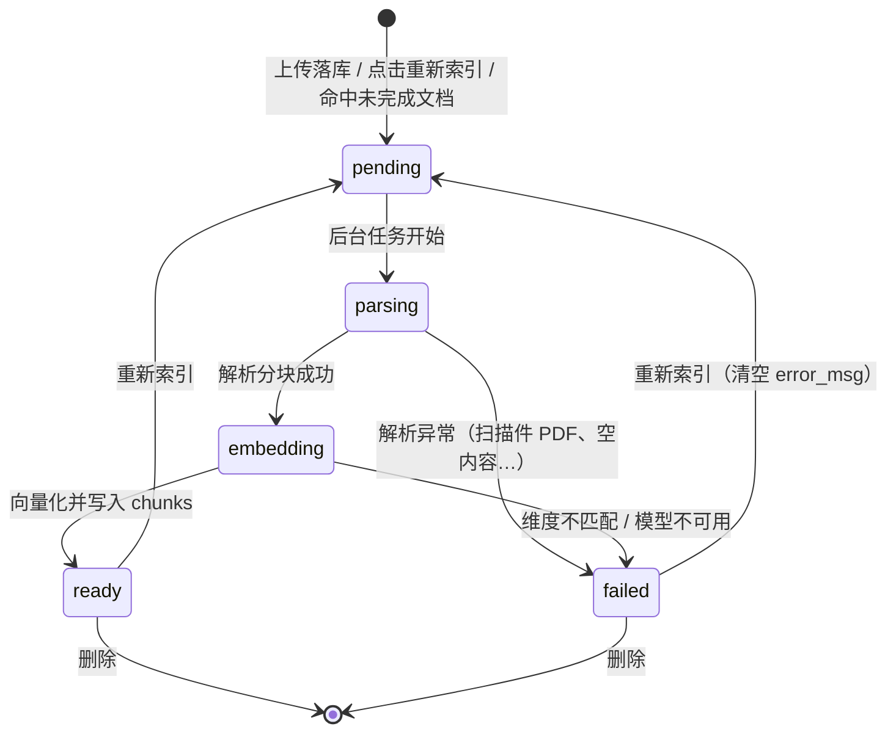
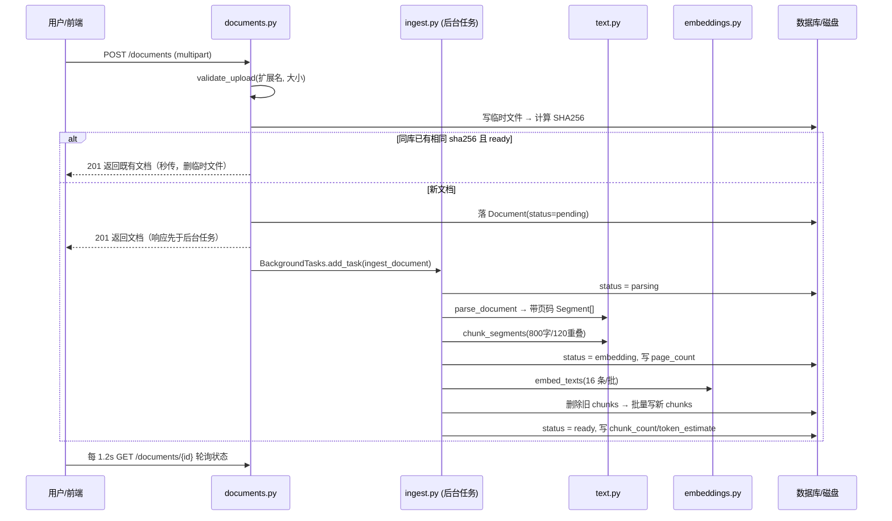
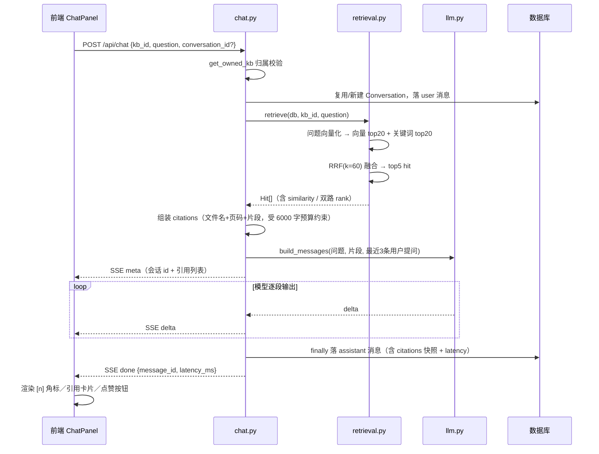

# 系统概要与详细设计说明书

> 项目：私有文档知识库问答助手（kb-assistant） · 版本 v1.0.0
> 上游文档：`docs/技术选型与需求分析.md` · 界面原型：`docs/02-UI原型设计说明书.md`
> 本文所有表结构、接口、状态机均与 `backend/app/`、`frontend/src/`、`src-tauri/src/` 实际代码逐项核对。

---

## 一、设计目标与约束

| 目标 | 设计应对 |
|---|---|
| 文档不出本机 | 全部组件本地运行；默认 `SQLite + 本地 Ollama`，无公网调用 |
| 答案必须可核对 | 检索片段带 `page_no`，Prompt 强制 `[n]` 标注，前端把角标映射回原文片段 |
| 零依赖即可跑通 | `hashing` 向量 + `mock` 回答 + SQLite 方言回退，clone 后不需要装模型/数据库 |
| 可平滑升级到生产 | provider 与数据库方言可插拔，只改 `.env` 不改业务代码 |
| 双形态复用 | Web 端与 Tauri 桌面端共用同一份 React 构建产物 |

**硬约束**：单文件 ≤ 20MB；支持 `.pdf/.docx/.md/.txt/.csv`；SSE 单向流式；JWT 无状态鉴权；知识库按 `owner_id` 隔离。

## 二、总体架构

### 2.1 分层视图



### 2.2 部署视图（三种形态）

| 形态 | 进程组成 | 数据库 | 模型 | 适用 |
|---|---|---|---|---|
| A 开发/演示零依赖 | `uvicorn` + `vite dev` | SQLite | hashing + mock | clone 后第一步、CI |
| B 本机生产 | `uvicorn` + 静态前端（或 Tauri 内置） | PostgreSQL + pgvector（或 SQLite） | Ollama `bge-m3` + `qwen2.5:3b` | 真实问答演示 |
| C 桌面安装包 | Tauri 主进程 → 自动拉起内置 venv 里的 uvicorn → WebView2 加载 `dist` | 安装包内置空白 SQLite | 同上（改安装目录 `.env`） | 交付/现场演示，免装 Python/Node |

> 端口：后端固定 `127.0.0.1:8000`（可用 `KB_BACKEND_PORT` 覆盖），Vite `5173`，Ollama `11434`。桌面端先探测 8000 端口，已有服务则直接复用，避免与 Web 端重复启动。

### 2.3 目录与模块职责

| 路径 | 职责 |
|---|---|
| `backend/app/api/` | `auth` `kb` `documents` `chat` 四个路由模块 + `deps` 鉴权依赖 |
| `backend/app/services/` | `text` 解析清洗分块 · `embeddings` 向量化 · `ingest` 入库状态机 · `retrieval` 混合检索 · `llm` Prompt 与流式生成 |
| `backend/app/core/` | `config` 环境配置与 JWT 密钥解析 · `security` PBKDF2 与 JWT |
| `backend/app/models.py` / `schemas.py` / `db.py` | ORM 7 表 + VectorType 方言 · Pydantic 出入参 · 引擎/建表/HNSW 索引 |
| `frontend/src/` | `pages/Login` `pages/Workspace` · `components/DocPanel` `components/ChatPanel` · `api.ts` REST/SSE 客户端 |
| `src-tauri/` | `main.rs` 窗口/托盘/快捷键/后端进程托管 · `windows/` 卸载清理 · `nsis/` 安装包兜底 |

## 三、数据设计

### 3.1 ER 关系



### 3.2 表结构（以 `models.py` 为准）

| 表 | 关键字段 | 约束 / 索引 |
|---|---|---|
| `users` | `id, email, password_hash, display_name, role, created_at` | `email` 唯一 + 索引；口令为 `pbkdf2_sha256$260000$盐$散列` |
| `knowledge_bases` | `id, owner_id→users.id, name, description, visibility, created_at` | `owner_id` 索引；级联删除其下文档/会话 |
| `documents` | `id, kb_id→kb.id, filename, mime_type, size_bytes, sha256, storage_path, status, page_count, chunk_count, token_estimate, error_msg, created_at` | **唯一约束 `(kb_id, sha256)` → 秒传**；`ix_documents_kb_status(kb_id,status)`；`sha256` 索引 |
| `chunks` | `id, doc_id→documents.id, kb_id→kb.id, chunk_index, content, char_count, page_no, embedding` | `doc_id`/`kb_id` 索引；PG 下 `embedding vector(DIM)` + HNSW 余弦索引 + `content` GIN trigram 索引 |
| `conversations` | `id, user_id, kb_id, title, created_at, updated_at` | `user_id` 索引；`messages` 按 id 排序级联 |
| `messages` | `id, conversation_id, role, content, citations(JSON), latency_ms, created_at` | `ix_messages_conv_id(conversation_id,id)`；`citations` 存引用快照，回看历史无需重检索 |
| `feedbacks` | `id, message_id, rating, comment, created_at` | `message_id` 索引；`rating ∈ {-1,1}` |

**方言兼容**：`VectorType(TypeDecorator)` 在 PostgreSQL 走 `pgvector.sqlalchemy.Vector(DIM)`，其它方言退化为 `Text` 存 JSON 数组；`init_db()` 在 PG 下自动 `CREATE EXTENSION vector/pg_trgm` 并建 HNSW / GIN 索引。切换数据库只改 `DATABASE_URL` 一行。

### 3.3 文档状态机



`failed` 时 `error_msg` 记录截断到 500 字的可读原因，前端在文档行内直接展示。前端 `DocPanel` 对 `pending/parsing/embedding` 每 1.2s 轮询一次，全部终态后停止并刷新侧边栏统计。

## 四、接口设计

### 4.1 端点清单（17 个业务端点 + 1 个健康检查）

| # | 方法 | 路径 | 鉴权 | 成功码 | 说明 |
|---:|---|---|---|---|---|
| 1 | POST | `/api/auth/register` | — | 201 | 注册并返回 token；邮箱重复 409 |
| 2 | POST | `/api/auth/login` | — | 200 | 登录；口令错 401 |
| 3 | GET | `/api/auth/me` | ✅ | 200 | 当前用户 |
| 4 | GET | `/api/kbs` | ✅ | 200 | 我的知识库列表（含文档/分块计数） |
| 5 | POST | `/api/kbs` | ✅ | 201 | 新建知识库 |
| 6 | GET | `/api/kbs/{id}` | ✅ | 200 | 详情；非本人 404 |
| 7 | DELETE | `/api/kbs/{id}` | ✅ | 204 | 先删 chunks/documents 再删库 |
| 8 | GET | `/api/kbs/{id}/documents` | ✅ | 200 | 文档列表（倒序） |
| 9 | POST | `/api/kbs/{id}/documents` | ✅ | 201 | multipart 上传，触发后台入库；秒传返回既有记录 |
| 10 | GET | `/api/kbs/{id}/documents/{doc_id}` | ✅ | 200 | 单个文档状态（前端轮询用） |
| 11 | POST | `/api/kbs/{id}/documents/{doc_id}/reindex` | ✅ | 200 | 重置为 pending 并重跑管线 |
| 12 | DELETE | `/api/kbs/{id}/documents/{doc_id}` | ✅ | 204 | 删记录并清理磁盘文件 |
| 13 | POST | `/api/chat` | ✅ | 200 | **SSE 流式问答** |
| 14 | GET | `/api/chat/conversations?kb_id=` | ✅ | 200 | 会话列表（最多 50） |
| 15 | GET | `/api/chat/conversations/{id}/messages` | ✅ | 200 | 历史消息（含引用快照） |
| 16 | DELETE | `/api/chat/conversations/{id}` | ✅ | 204 | 删除会话及消息 |
| 17 | POST | `/api/chat/feedback` | ✅ | 201 | 点赞/点踩 |
| — | GET | `/health` | — | 200 | 返回 db/embed/llm provider，部署自检用 |

全部接口由 FastAPI 自动生成 OpenAPI，运行后访问 `http://127.0.0.1:8000/docs`。

### 4.2 SSE 事件契约（`POST /api/chat`）

```
Content-Type: text/event-stream
Cache-Control: no-cache

data: {"type":"meta","conversation_id":1,"citations":[{"index":1,"chunk_id":3,"doc_id":1,
        "filename":"手册.pdf","page_no":2,"snippet":"…","score":1.0,"similarity":0.5972}]}

data: {"type":"delta","content":"**35 摄氏度**"}

data: {"type":"error","message":"生成失败：…"}       # 仅异常时出现

data: {"type":"done","message_id":12,"latency_ms":1830,"error":null}
```

前端 `streamChat()` 按 `type` 分发：`meta` → 渲染来源列表；`delta` → 追加正文；`done` → 记下 `message_id` 供点赞；`error` → 顶部错误条。`generate()` 的 `finally` 无论生成成功与否都会把回答与引用落库，保证「一问一答两条消息」的账实一致。

### 4.3 错误码约定

| 码 | 语义 | 典型触发 |
|---|---|---|
| 400 | 业务校验失败 | 不支持的扩展名 / 空文件 / >20MB |
| 401 | 未登录或 token 失效 | 缺 `Authorization`、伪造/过期 token、口令错误 |
| 403 | 已登录但无权操作 | 评价他人消息 |
| 404 | 资源不存在或**无权访问** | 越权访问他人知识库/文档/会话（不泄露存在性） |
| 409 | 冲突 | 邮箱重复注册 |
| 422 | Pydantic 入参校验失败 | 邮箱格式、密码长度、`rating` 越界 |

## 五、关键流程时序

### 5.1 文档入库（离线管线）



### 5.2 在线问答



## 六、关键算法与设计决策

| 决策 | 方案 | 理由 / 权衡 |
|---|---|---|
| 分块 | 段落→句子切分，块长 800 字、重叠 120 字，<30 字残块并回上一块 | 避免把结论与条件切到两块；保留 `page_no` 才能溯源 |
| 清洗 | 去孤立页码/「第 N 页 / 共 M 页」页脚、合并 PDF 硬换行、保护标题与列表 | 页脚会污染向量；标题不能与正文拼接 |
| 去重 | `(kb_id, sha256)` 唯一约束 + 上传前比对 | 同内容换文件名不重复解析；限定在**同一知识库**内，跨库仍各自持有 |
| 检索 | 向量召回 top20 + 关键词召回 top20，RRF `score = Σ 1/(60+rank)` 融合取 top5 | 纯向量对型号/专有名词不敏感，关键词补洞；RRF 无需调两路分数尺度 |
| 关键词提取 | 中文 bigram + 英文数字整体，**按出现顺序去重保序**，拉丁型号词优先，取前 6 | 保证跨进程结果可复现（修复了 set 排序导致的不确定性缺陷） |
| 上下文 | 片段带编号、文件名、页码；系统提示 8 条硬约束（只用片段、逐条标 `[n]`、无依据拒答、关键信息加粗、≤300 字…） | 抑制幻觉、保证引用可核对 |
| 历史 | 只把最近 3 条**用户提问**作为「历史提问」附注，不把历史 assistant 回答作为独立消息 | 小参数模型会照抄上一轮答案当模板，导致后续回答漏掉条件与例外 |
| 生成 | `temperature=0` 贪心解码；SSE 逐段推送；异常时推 `error` 事件而非静默失败 | 本地 3B 模型随机波动会漏标引用 |
| 引用存储 | `messages.citations` 存快照 | 历史回看不依赖重新检索，文档删除后引用仍可展示 |
| 鉴权 | PBKDF2-SHA256 26 万次 + 随机盐；HS256 JWT（7 天）；弱示例密钥自动替换为本机随机密钥 | 免注册泄露；多实例部署需显式配置同一 `JWT_SECRET` |
| 桌面端 | Tauri 2 + Rust 后台线程拉起 uvicorn、端口探测复用、托盘常驻、关闭隐藏、`Ctrl+Shift+K` 唤起 | 相比 Electron 体积小一个数量级；退出时 kill 子进程避免残留 |
| 打包隔离 | `resources` 显式白名单，只含 `app/`、`scripts/`、`requirements.txt`、`.env.example`、`.venv`、卸载脚本 | 绝不带出开发机 `.env`、`app.db`、`uploads/`、`*.bak` |

## 七、需求 ↔ 设计 ↔ 代码追溯

| 需求 | 设计章节 | 代码入口 |
|---|---|---|
| F1 注册登录 | §4.1 #1-3、§6 鉴权 | `api/auth.py`、`core/security.py`、`pages/Login.tsx` |
| F2 知识库管理 | §3.2、§4.1 #4-7 | `api/kb.py`、`pages/Workspace.tsx` |
| F3 文档入库 | §3.3、§5.1、§6 分块 | `services/text.py`、`services/ingest.py`、`components/DocPanel.tsx` |
| F4 流式问答 | §4.2、§5.2 | `api/chat.py`、`services/llm.py`、`components/ChatPanel.tsx` |
| F5 引用溯源 | §3.2 `page_no`、§4.2 | `services/retrieval.py`、`ChatPanel.renderContent()` |
| F6 会话历史 | §3.2 `conversations/messages` | `api/chat.py`、`ChatPanel.openConv()` |
| F7 秒传去重 | §5.1、§6 | `api/documents.py` 的 sha256 比对 |
| F8 混合检索 | §6 检索 | `services/retrieval.py` |
| F9 拒答 | §6 上下文 | `services/llm.py` 的 `SYSTEM_PROMPT` |
| F10 反馈 | §3.2 `feedbacks`、§4.1 #17 | `api/chat.py`、`ChatPanel.vote()` |
| F11 失败可见/重索引 | §3.3 状态机、§4.1 #11 | `services/ingest.py`、`api/documents.py`（**前端按钮缺失，见测试报告 OBS-01**） |
| 客户端加分 | §2.2 形态 C | `src-tauri/src/main.rs`、`src-tauri/nsis/` |

## 八、已知限制

1. 定位为本机/局域网单机使用；公网部署需自行补 TLS、速率限制、注册管控与上传内容扫描；
2. `OllamaEmbedder` / `OpenAIEmbedder` 与 LLM 共用 `LLM_BASE_URL`，不能把对话模型与向量模型指向两个不同服务；
3. 换 embedding provider 必须同步改 `EMBED_DIM`、重启后端并运行 `scripts/reindex_all.py` 重建全部索引，否则新旧维度混用会报错；
4. 安装包内置 `.venv` 的 `pyvenv.cfg` 指向打包机 Python 路径，换到无该 Python 的机器需运行 `prepare-backend.bat` 重建；
5. SQLite 回退方言无 HNSW 索引，向量检索在应用层用 numpy 计算，适合开发与十万块以下数据；
6. 真实本地 3B 模型完整生成耗时约 11s，与需求文档「首字 < 2s」的口径需区分计量（见测试报告 OBS-02）。
