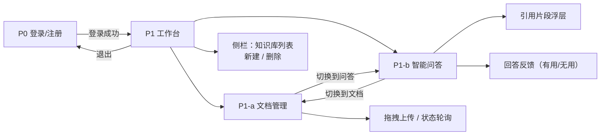

# UI 原型设计说明书

> 项目：私有文档知识库问答助手 · 版本 v1.0.0
> 配套可交互原型：**`docs/prototype/index.html`**（双击用浏览器打开即可，无需安装任何依赖）
> 实现对照：`frontend/src/pages/`、`frontend/src/components/`、`frontend/src/index.css`

---

## 一、原型目标与交付形态

| 阶段 | 产物 | 说明 |
|---|---|---|
| 低保真 | 本文 §3 的线框图 + §4 页面流转 | 确定信息架构、区块比例、控件位置，先于编码完成 |
| 高保真 | `docs/prototype/index.html` | 与真实产品同色板/同布局的可点击原型，内置演示数据与模拟流式问答 |
| 实现 | React 18 + TypeScript 组件 | 原型定稿后按组件拆分实现，接口由 `frontend/src/api.ts` 承接 |

原型刻意**不引入组件库**：登录卡片、侧边栏、文档表格、聊天气泡、引用角标全部手写，便于逐像素对齐设计稿，也让「UI 全部自研」在答辩时可举证。

## 二、信息架构与页面清单



| 页面 ID | 名称 | 入口 | 主要控件 | 对应需求 |
|---|---|---|---|---|
| P0 | 登录 / 注册 | 未登录时默认 | 邮箱、密码、昵称（注册态）、模式切换、错误提示 | F1 |
| P1 | 工作台外壳 | 登录成功 | 品牌区、新建知识库、知识库列表（含文档/分块计数）、用户信息、删除/退出 | F2 |
| P1-a | 文档管理 | 默认 Tab | 上传按钮、拖拽区、格式提示、文档表格（文件名/大小/页&块/状态徽章/删除） | F3、F7、F11 |
| P1-b | 智能问答 | 切换 Tab | 会话下拉、新对话、流式消息区、引用角标与来源卡、片段浮层、耗时与反馈、输入框 | F4、F5、F6、F9、F10 |
| P2 | 引用片段浮层 | 点击 `[n]` 或来源卡 | 原文片段、来源文件名与页码 | F5 |
| — | 桌面端增强 | Tauri 窗口 | 系统托盘、双击托盘显示、`Ctrl+Shift+K` 全局唤起、关闭最小化到托盘 | 客户端加分 |

## 三、低保真线框

### 3.1 P0 登录 / 注册（360px 居中卡片）

```
┌──────────────────────────────────────────────┐
│                                              │
│      ┌──────────────────────────────┐        │
│      │  私有知识库问答助手           │        │
│      │  文档不出本机 · 回答必须标注出处│       │
│      │  ┌────────────────────────┐  │        │
│      │  │ [错误提示，仅失败时出现] │  │        │
│      │  └────────────────────────┘  │        │
│      │  邮箱                        │        │
│      │  ┌────────────────────────┐  │        │
│      │  │ you@example.com        │  │        │
│      │  └────────────────────────┘  │        │
│      │  密码                        │        │
│      │  ┌────────────────────────┐  │        │
│      │  │ ••••••                 │  │        │
│      │  └────────────────────────┘  │        │
│      │  [昵称，仅注册态]            │        │
│      │  ┌────────────────────────┐  │        │
│      │  │ 怎么称呼你             │  │        │
│      │  └────────────────────────┘  │        │
│      │  ┌────────────────────────┐  │        │
│      │  │        登  录          │  │        │
│      │  └────────────────────────┘  │        │
│      │   还没有账号？注册一个       │        │
│      └──────────────────────────────┘        │
│                                              │
└──────────────────────────────────────────────┘
```

### 3.2 P1 工作台 / P1-a 文档管理

```
┌──────────────┬───────────────────────────────────────────────────────┐
│ 📚 私有知识库 │  结课答辩演示库        [ 文档管理 ][ 智能问答 ]         │
│ ┌──────────┐ │ ───────────────────────────────────────────────────── │
│ │＋新建知识库│ │  [⬆ 选择文件上传]  支持 PDF/DOCX/MD/TXT/CSV，单文件≤20MB│
│ └──────────┘ │ ┌───────────────────────────────────────────────────┐ │
│ ┌──────────┐ │ │ 文件名                 大小    页·块    状态   操作 │ │
│ │演示库  ● │ │ │ 员工手册.pdf          218KB  12页·18块  ✅就绪 删除│ │
│ │ 文档 3   │ │ │ 产品说明书.docx        96KB   6页·9块   ✅就绪 删除│ │
│ │ 分块 32  │ │ │ 扫描件.pdf            1.2MB  —        ❌失败  删除│ │
│ ├──────────┤ │ │   └ 红色错误原因文案                              │ │
│ │路线图    │ │ │ FAQ.txt                12KB   1页·2块   ⟳入库中 删除│ │
│ │ 文档 1   │ │ └───────────────────────────────────────────────────┘ │
│ │ 分块 5   │ │  ↑ 拖拽文件到面板任意位置可上传（虚线高亮）            │
│ └──────────┘ │                                                       │
│──────────────│                                                       │
│ 演示账号      │                                                       │
│ [删除当前库][退出]                                                    │
└──────────────┴───────────────────────────────────────────────────────┘
   250px                        自适应剩余宽度
```

### 3.3 P1-b 智能问答

```
┌──────────────┬───────────────────────────────────────────────────────┐
│ （同左侧栏） │  结课答辩演示库        [ 文档管理 ][ 智能问答 ]         │
│              │ ───────────────────────────────────────────────────── │
│              │  [— 新对话 — ▾] [＋新对话]              ● 正在生成…     │
│              │ ┌───────────────────────────────────────────────────┐ │
│              │ │                        ┌──────────────────────┐  │ │
│              │ │                        │ 温度超过多少度会告警？│  │ │
│              │ │                        └──────────────────────┘  │ │
│              │ │  ┌────────────────────────────────────────────┐   │ │
│              │ │  │ **35 摄氏度**[1]，且需连续 3 个采样点[1]。 │   │ │
│              │ │  │ 相对湿度低于 20% 触发干燥告警[2]。          │   │ │
│              │ │  └────────────────────────────────────────────┘   │ │
│              │ │  [1] 系统设计说明.md·第1页  [2] 员工手册.pdf·第3页 │ │
│              │ │  ┌ 点击角标后展开 ──────────────────────────┐    │ │
│              │ │  │ 原文片段（snippet）…                      │    │ │
│              │ │  └──────────────────────────────────────────┘    │ │
│              │ │  耗时 1830ms   [有用] [无用]                     │ │
│              │ └───────────────────────────────────────────────────┘ │
│              │  ┌────────────────────────────────┐ ┌──────┐          │
│              │  │ 输入问题，Ctrl+Enter 发送       │ │ 发送 │          │
│              │  └────────────────────────────────┘ └──────┘          │
└──────────────┴───────────────────────────────────────────────────────┘
```

## 四、交互规格

| ID | 触发 | 系统行为 | 反馈 | 异常/边界 |
|---|---|---|---|---|
| I-01 | 点「注册一个」 | 登录卡片切换为注册态，追加昵称字段 | 按钮文案变「注册并登录」 | — |
| I-02 | 提交登录/注册 | 调 `/api/auth/login` 或 `/register`，成功后 token 存 localStorage | 进入工作台 | 失败在卡片顶部红条显示原因 |
| I-03 | 点「＋新建知识库」 | 侧栏展开输入框，回车/确认提交 | 新库置顶并自动选中，切到文档 Tab | 空名称不提交 |
| I-04 | 选择知识库 | 右侧标题与两个 Tab 内容随 `kbId` 重载 | 选中项高亮 | 无库时显示空态引导 |
| I-05 | 选择文件 / 拖拽到文档面板 | 逐个 POST 上传，随后刷新列表 | 拖拽时面板虚线高亮；按钮显示「上传中…」 | 扩展名/大小不符 400 → 红色错误条 |
| I-06 | 存在 `pending/parsing/embedding` 文档 | 每 1.2s 轮询文档状态 | 「⟳ 解析中 / 向量化中」徽章 | 全部终态后停止轮询并刷新侧栏计数 |
| I-07 | 入库失败 | 文档行展示 `error_msg` | 红色徽章 ❌ 失败 | 后端支持重新索引（前端按钮待补，见 OBS-01） |
| I-08 | 切到「智能问答」 | 载入会话列表，默认新对话 | 空态提示示例问题 | — |
| I-09 | 发送问题（按钮 / `Ctrl+Enter`） | 追加一问一答两条占位消息；`streamChat` 消费 SSE | `meta` 渲染来源卡 → `delta` 逐字追加 → `done` 显示耗时与反馈按钮 | `error` 事件显示红条；生成中禁用发送 |
| I-10 | 点 `[n]` 角标或来源卡 | 展开/收起对应原文片段浮层 | 浮层显示文件名、页码、片段 | 引用找不到时角标降级为纯文本 |
| I-11 | 点「有用 / 无用」 | POST `/api/chat/feedback` | 按钮变为「已反馈」 | 无 `message_id` 时不显示按钮 |
| I-12 | 选择历史会话 | 拉取该会话消息（含引用快照） | 完整还原多轮对话 | 刷新不丢失（服务端落库） |
| I-13 | 删除知识库/文档/退出 | 二次确认后调用删除接口 | 列表即时更新 | 删除库会级联删光文档与向量 |
| I-14 | 桌面端 `Ctrl+Shift+K` | 窗口显示/隐藏切换 | — | 关闭按钮=最小化到托盘，托盘「退出」才真正退出 |

## 五、视觉设计规范

色板直接取自 `frontend/src/index.css` 的 CSS 变量，原型与实现共用同一套值：

| 变量 | 值 | 用途 |
|---|---|---|
| `--bg` | `#f6f7fb` | 页面底色 |
| `--panel` | `#ffffff` | 卡片、侧栏、表格、助手气泡 |
| `--border` | `#e5e7ef` | 分隔线、描边 |
| `--text` | `#1c2030` | 主文字 |
| `--muted` | `#6b7280` | 次要文字、提示、耗时 |
| `--accent` | `#4f5bd5` | 主按钮、选中态、引用角标、用户气泡 |
| `--accent-weak` | `#eceefc` | 选中背景、引用卡片 |
| `--danger` / `--ok` / `--warn` | `#d64545` / `#1d9e75` / `#b26b0b` | 错误 / 就绪 / 进行中 |
| `--radius` | `10px` | 通用圆角（登录卡 16px、气泡 14px、Tab 999px） |

- 字体：`"Segoe UI", "Microsoft YaHei", system-ui`，基准 14px；
- 布局：侧栏固定 250px，主区自适应，整体 `height:100vh`，内容区独立滚动；
- 状态徽章：`ready` 绿、`pending/parsing/embedding` 黄（带 ⟳）、`failed` 红（行内附错误原因）；
- 流式渲染：助手气泡内 `**加粗**` 解析为强调色、提问关键词在命中片段中高亮、引用 `[n]` 渲染成可点击上标；
- 空态：每个面板都有明确引导语（「还没有知识库，先新建一个」「向知识库提问，例如…」），不出现空白死区。

## 六、需求 → 界面追溯

| 需求 | 原型位置 | 实现组件 |
|---|---|---|
| F1 | P0 | `pages/Login.tsx` |
| F2 | P1 侧栏 | `pages/Workspace.tsx` |
| F3 / F7 / F11 | P1-a 上传区、表格、状态徽章 | `components/DocPanel.tsx` |
| F4 / F5 / F6 / F9 / F10 | P1-b 消息区、角标、来源卡、会话下拉、反馈按钮 | `components/ChatPanel.tsx` |
| 桌面端能力 | 原型右上角「桌面端能力」标注 | `src-tauri/src/main.rs` |

## 七、原型与实现的边界

`docs/prototype/index.html` 是**设计验证用**的静态原型：

- 数据是内置演示数据（虚构的「云澜科技」文档，与 `demo-files/` 一致），登录不做真实校验；
- 「流式回答」用 `setInterval` 逐字模拟 SSE `delta` 事件，事件序列（`meta → delta… → done`）与真实接口一致，但不发起任何网络请求；
- 拖拽上传只在本地追加表格行，不写磁盘；
- 真实交互由 React 组件 + `frontend/src/api.ts` 的 REST/SSE 客户端完成，接口契约见 `docs/01-系统概要与详细设计说明书.md` §4。

这样安排的目的：答辩现场在无后端、无网络、无模型的机器上也能完整演示界面与交互流程，而不依赖真实服务。
